# HRNexus

A multi-tenant HR management SaaS built with the MERN stack. Each company signs up and gets its own private workspace for employees, attendance, leave and payroll.

**Live demo:** https://hr-nexus-gm73.vercel.app
**API:** https://hr-nexus-mocha.vercel.app

There is no default login. Open the app, click **Start free** and create a company.

## Key Features

- **Multi-tenancy:** every record belongs to a company, and the company is always taken from the JWT, so companies cannot see each other's data
- **Plans:** Free (up to 10 employees) and Pro (unlimited); the upgrade flow is a demo with no real payment
- **Roles:** Superadmin, Admin, HR, Manager and Employee, with role-based access control
- **Employees:** create, edit and delete employee profiles, salary structure and bank details
- **Attendance:** manual entry plus a biometric device webhook (ADMS-compatible devices)
- **Shifts:** custom shifts with grace periods and break times
- **Leave management:** apply, approve and reject leave with balance tracking
- **Payroll:** salary calculation based on attendance, approved leave, overtime, late arrivals, allowances and deductions
- **Payslips:** PDF payslips per employee per month
- **Excel export:** attendance and payroll reports as `.xlsx` files
- **Superadmin dashboard:** platform owner view of all companies, signups and plan breakdown

## Tech Stack

| Layer | Technology |
|---|---|
| Frontend | React 19, Vite, Tailwind CSS v4, React Router, Axios, Recharts, Framer Motion |
| Backend | Node.js, Express 5 |
| Database | MongoDB with Mongoose |
| Auth | JWT, bcrypt |
| Files | PDFKit (payslips), ExcelJS (reports) |
| Hosting | Vercel (frontend and API) |

## Screenshots

The screenshots use made-up demo data. Emails in the superadmin view are masked.

| Landing | Pricing |
|---|---|
| 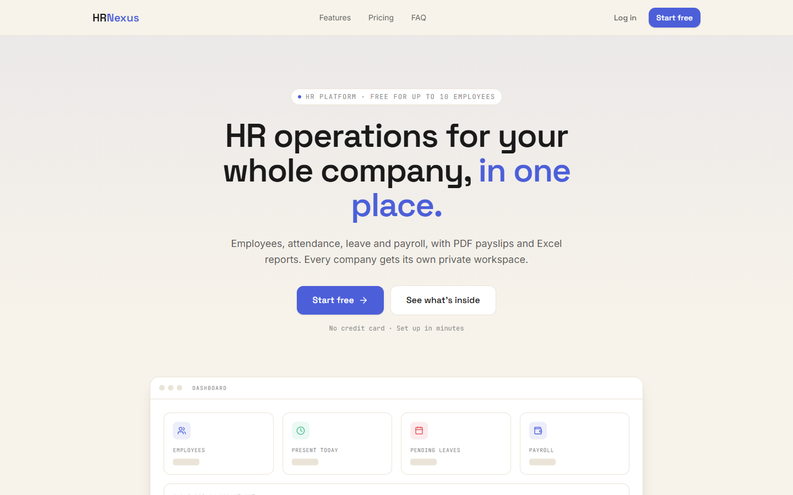 | 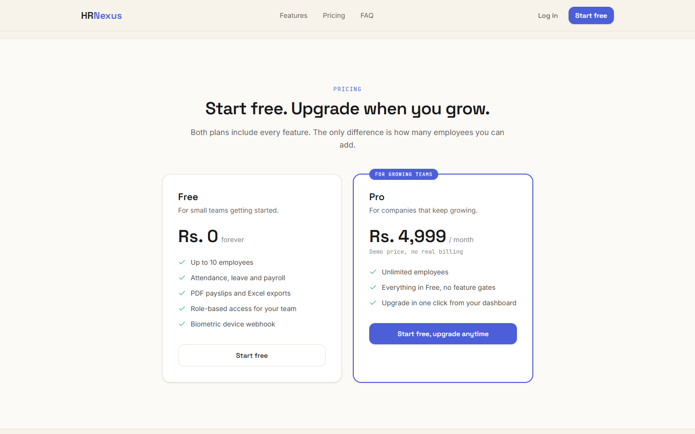 |

| Company signup | Dashboard with plan usage |
|---|---|
| 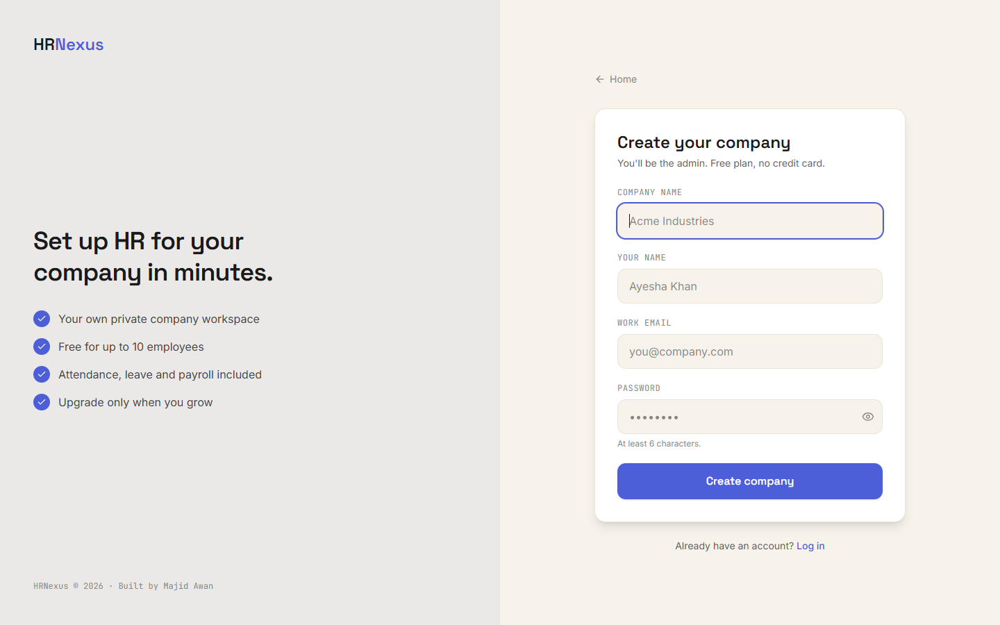 | 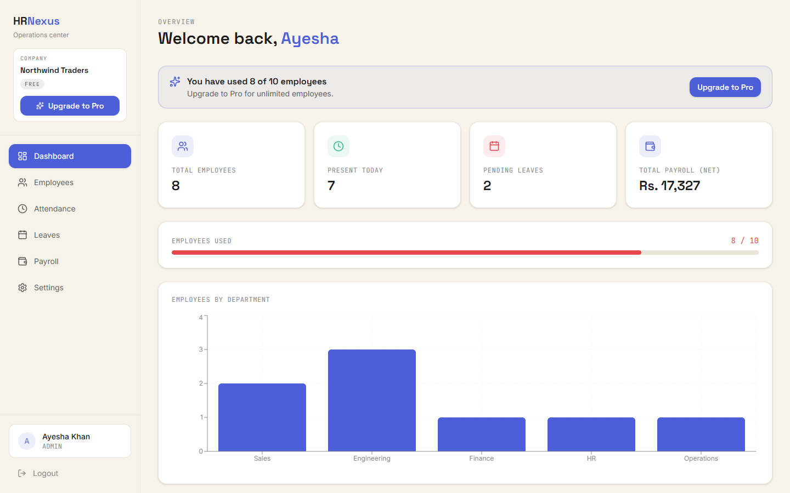 |

| Employees | Leaves |
|---|---|
| 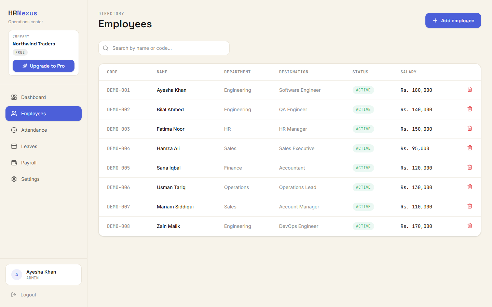 | 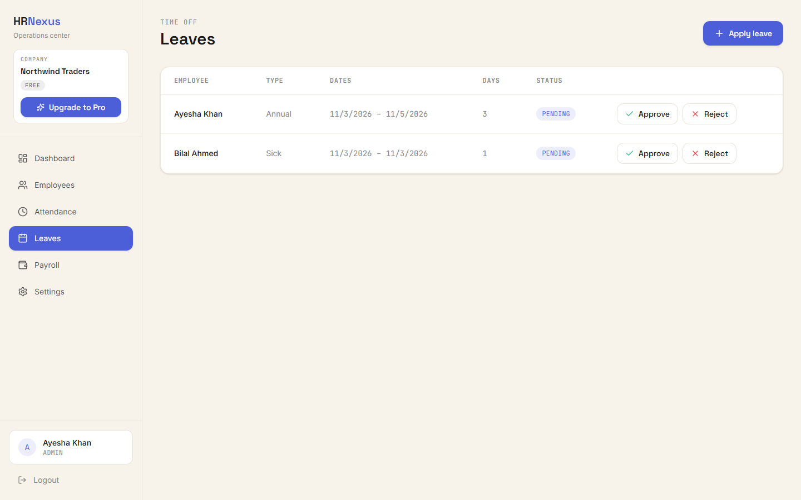 |

| Payroll and payslips | Upgrade modal (demo, no real payment) |
|---|---|
| 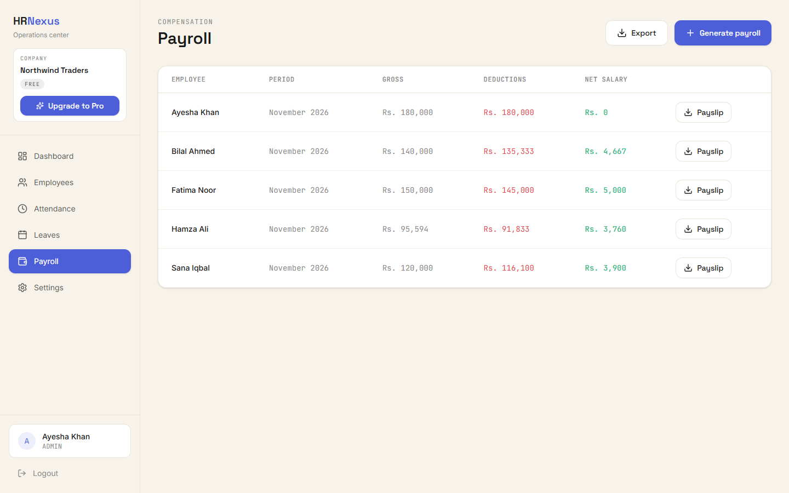 | 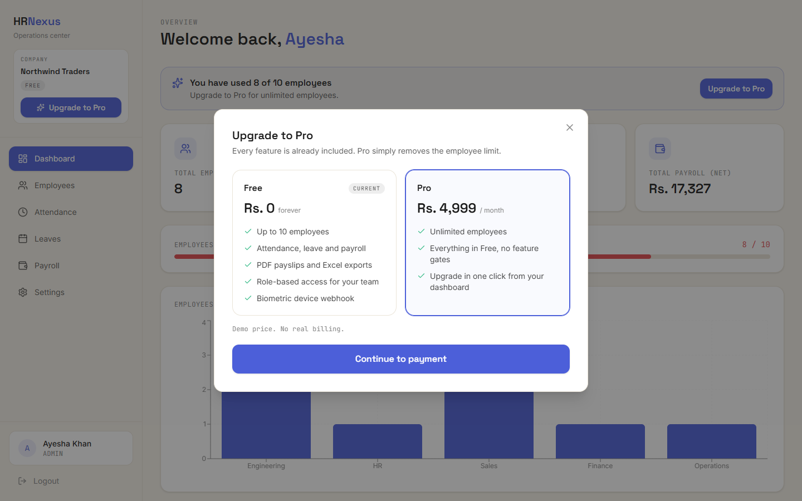 |

| Settings | Superadmin dashboard |
|---|---|
| 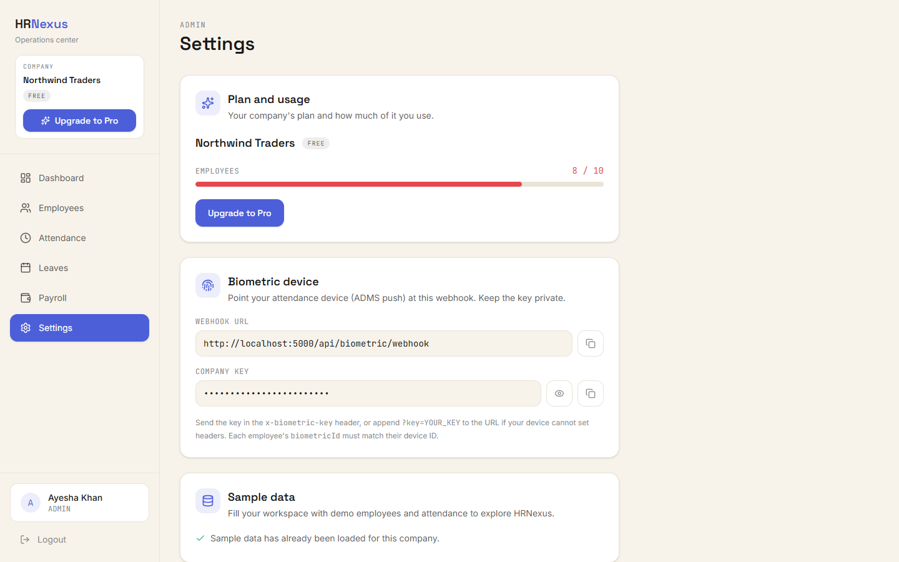 | 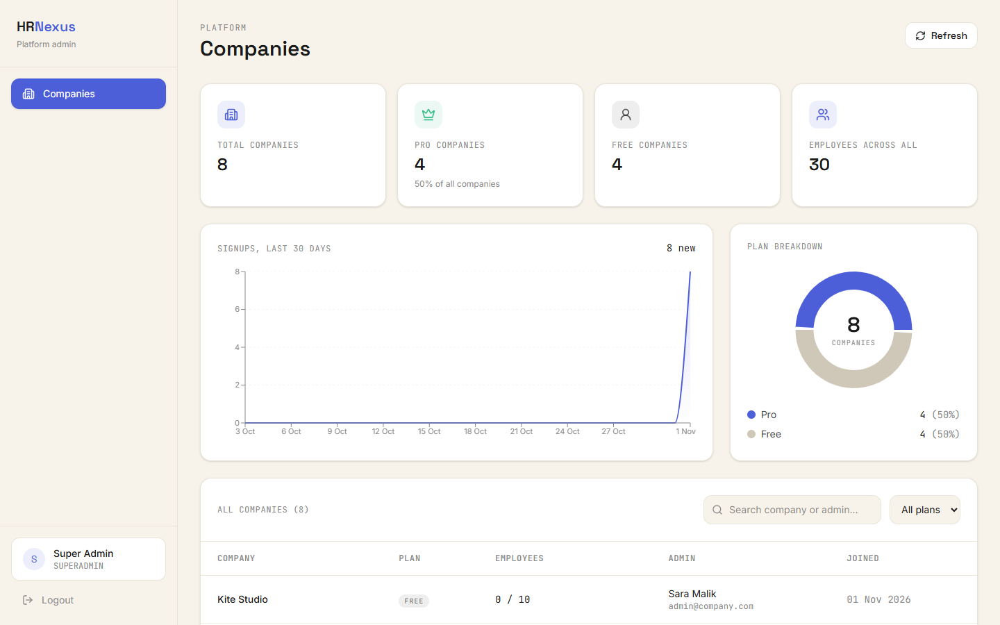 |

**Mobile**

<p>
  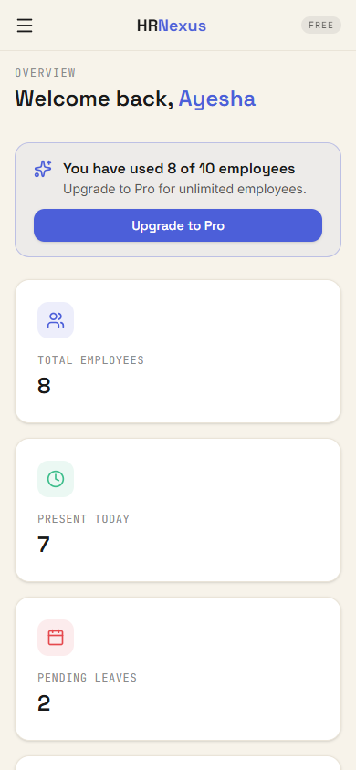
  &nbsp;
  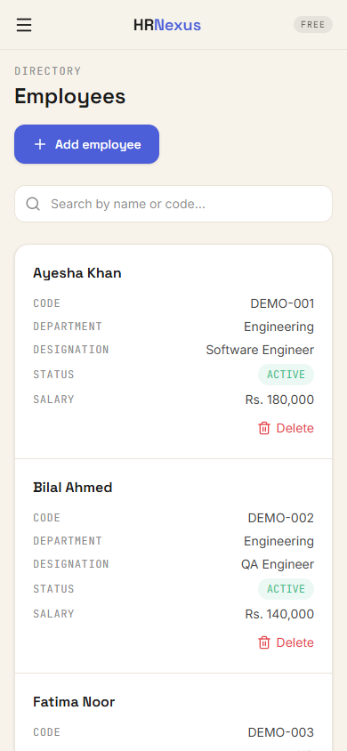
</p>

## Getting Started

### Prerequisites

- Node.js 18 or later
- A MongoDB database (local or MongoDB Atlas)

### Backend

```bash
cd backend
npm install
# create backend/.env with the variables listed below
npm run seed     # creates the superadmin account only
npm run dev      # http://localhost:5000
```

### Frontend

```bash
cd frontend
npm install
npm run dev      # http://localhost:5173
```

In development the frontend reads the API URL from `frontend/.env.development`.

## Environment Variables

**backend/.env**

| Name | Purpose |
|---|---|
| `MONGO_URI` | MongoDB connection string |
| `JWT_SECRET` | Secret used to sign JWTs |
| `PORT` | API port (optional, defaults to 5000) |
| `SUPERADMIN_EMAIL` | Superadmin login created by `npm run seed` |
| `SUPERADMIN_PASSWORD` | Superadmin password (at least 8 characters) |
| `SUPERADMIN_NAME` | Superadmin display name (optional) |

**frontend**

| Name | Purpose |
|---|---|
| `VITE_API_URL` | Base URL of the API, for example `http://localhost:5000/api` |

## More Details

- [Backend README](backend/README.md): API reference and backend setup
- [Frontend README](frontend/README.md): frontend structure

## Author

**Majid Awan** · [Portfolio](https://majid-awan-updated-portfolio-stzz.vercel.app) · [LinkedIn](https://www.linkedin.com/in/majid-awan-8210943a3) · [GitHub](https://github.com/majidawan01)
