# HRNexus

A multi-tenant HR SaaS built with the MERN stack. Each company signs up on its own and gets a private workspace for employees, attendance, leave and payroll, on a Free (up to 10 employees) or Pro (unlimited) plan. A superadmin view lets the platform owner see every company.

**Developed by Majid Awan**

- [Frontend README](frontend/README.md): React 19, Vite, Tailwind v4
- [Backend README](backend/README.md): Express 5, MongoDB, API reference and setup

## Screenshots

| Landing | Pricing |
|---|---|
| 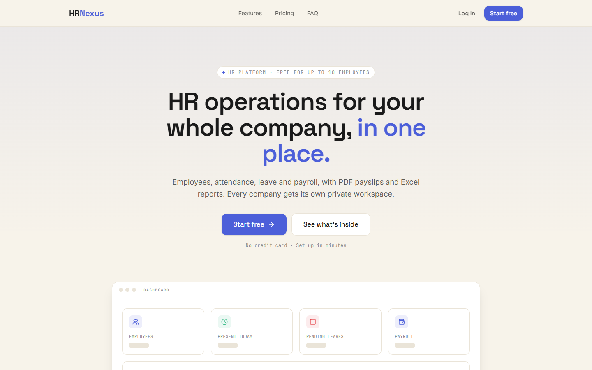 | 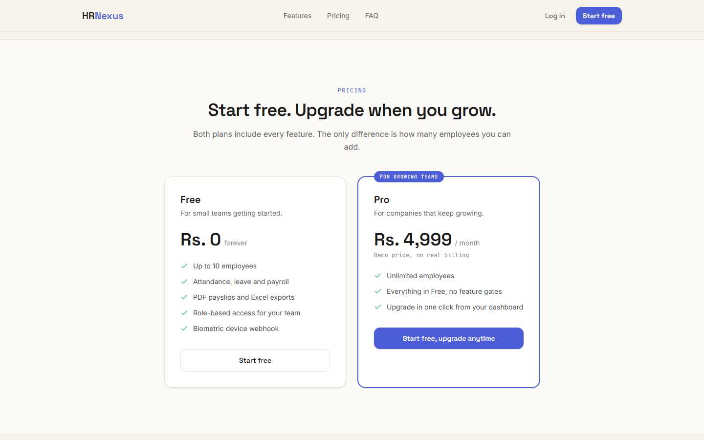 |

| Company signup | Dashboard with plan usage |
|---|---|
| 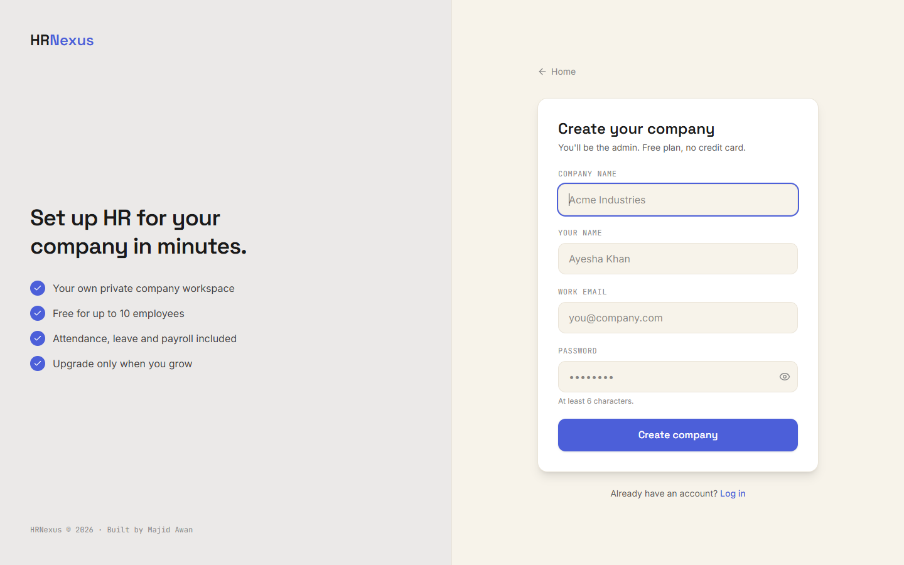 | 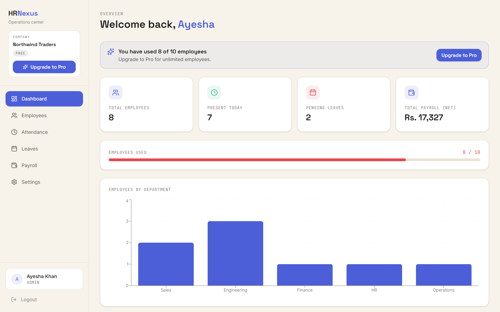 |

| Employees | Leaves |
|---|---|
| 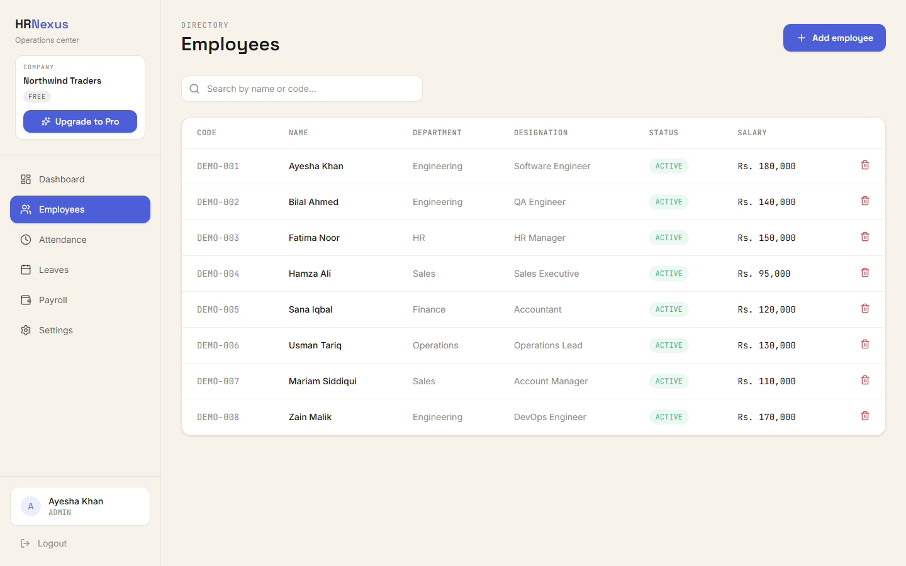 | 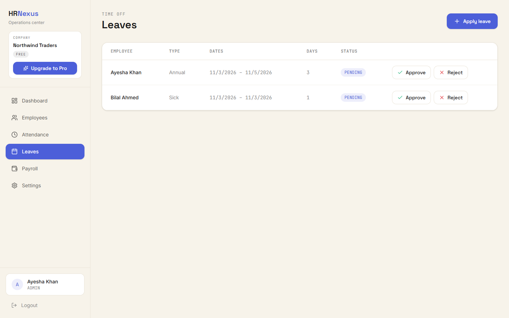 |

| Payroll and payslips | Upgrade modal (demo, no real payment) |
|---|---|
| 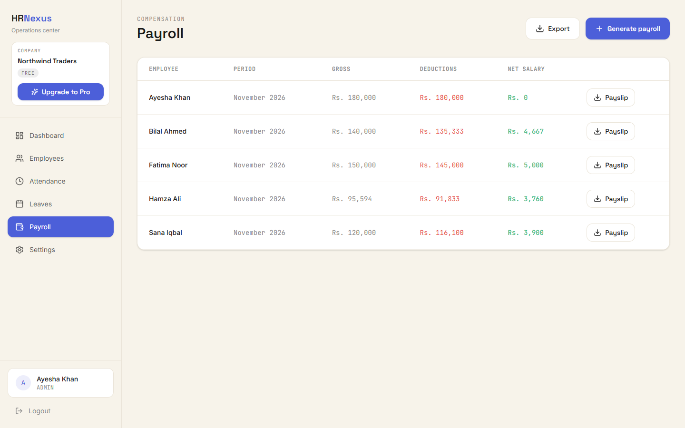 | 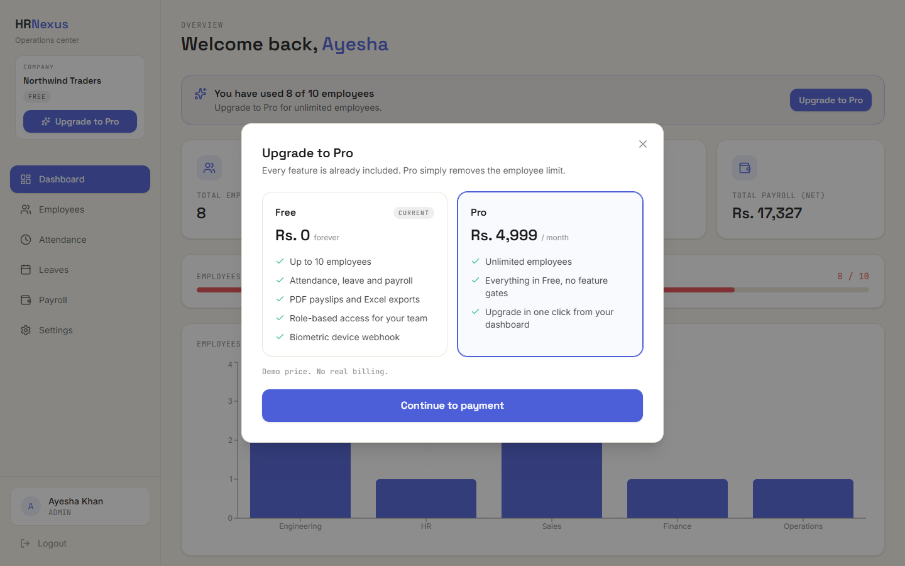 |

| Settings | Superadmin dashboard |
|---|---|
| 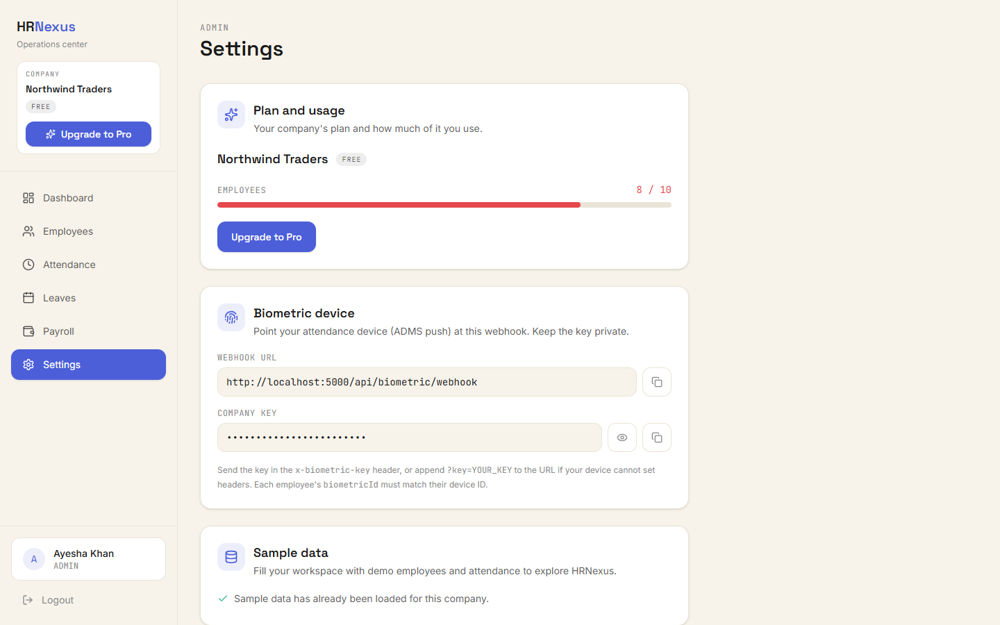 | 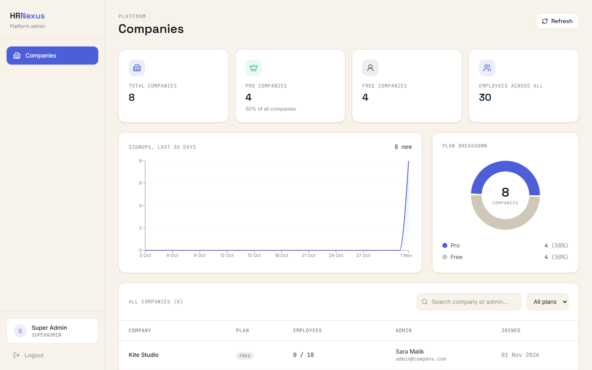 |

**Mobile**

<p>
  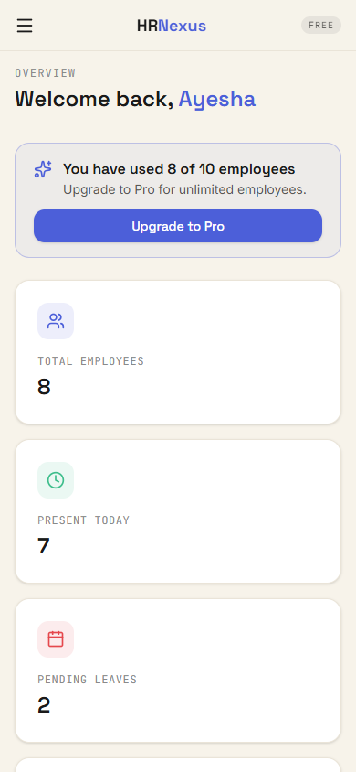
  &nbsp;
  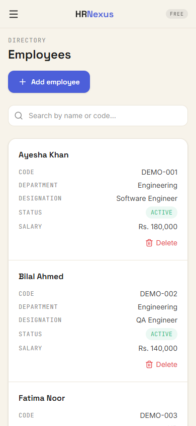
</p>

The screenshots use made-up demo data (sample companies and employees). Emails in the superadmin view are masked.

## Quick start

```bash
# backend
cd backend && npm install
# create .env (MONGO_URI, JWT_SECRET, SUPERADMIN_*), then:
npm run seed     # creates the superadmin only
npm run dev      # http://localhost:5000

# frontend
cd frontend && npm install
npm run dev      # http://localhost:5173
```

There is no default login. Open the app, click **Start free** and create a company. Details are in the two READMEs above.
